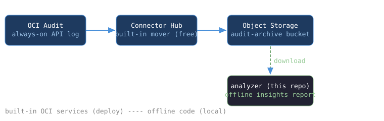

# oci-ootb-audit-log-insights

An OOTB (out-of-the-box) OCI project with working, tested code: **who did what in your tenancy, from archived audit logs** - a pipeline wired only from Oracle Cloud's built-in services, plus a real offline analyzer.

**OCI Audit (always on) records every API call -> Connector Hub archives the events to an Object Storage bucket -> this repo's analyzer turns the archive into an insights report**: top principals, source IPs, operations, response statuses, 4xx denials, write operations, per-day timeline.



| Built-in OCI feature | Role here | Cost (Oracle published pages, checked 28 Oct 2026) |
|---|---|---|
| Audit service | Records all API calls as log events | Always on; [365-day retention](https://docs.oracle.com/en-us/iaas/Content/Audit/Tasks/settingretentionperiod.htm) |
| Connector Hub | Moves audit events into the bucket | [Free](https://www.oracle.com/application-development/connector-hub/pricing/) (standard rates for source/target services) |
| Object Storage bucket (`audit-archive`) | Holds the archived batches | [20 GB Always Free](https://docs.oracle.com/en-us/iaas/Content/FreeTier/freetier_topic-Always_Free_Resources.htm) |

Limits, regions and billing are Oracle's to change; the links are the source of truth.

## Run it locally (no OCI needed)

```
python3 -m unittest discover -s tests -v   # 21 tests
python3 scripts/demo.py                    # builds a synthetic audit archive, then analyzes it
python3 scripts/validate.py                # deploy-config consistency check (exit 0/1/2)
python3 -m analyzer tests/fixtures/        # analyze the sample fixture
```

The demo writes two JSON-lines files (one gzipped, like the batches Connector
Hub produces), then prints the real analyzer report. **This is a local run on
synthetic events, not a live OCI analysis.**

## The analyzer (`analyzer/`)

Stdlib-only. Reads `.jsonl`, `.json` and `.gz` files (or directories of
them), tolerates malformed lines (skipped, counted), parses the documented
audit event shape (`datetime` ms epoch, `data.eventName`,
`data.identity`, `data.request`, `data.response`), and reports:

- top principals and source IPs (who, from where)
- top operations and response-status breakdown
- denied calls (4xx) with principal, operation and time
- write operations (POST/PUT/DELETE/PATCH) vs reads
- events per day timeline

Exit codes: 0 report produced, 1 bad input, 2 no valid audit events found.
`--json` for machine-readable output.

## Status: prepared, not deployed

**Nothing here has been deployed: no OCI resources exist for this project yet, and the deploy steps in [docs/setup.md](docs/setup.md) have not been executed on a live tenancy.** The configs carry `<...>` placeholders to fill at deploy time (`scripts/validate.py` flags exactly those). Creating resources is your call on your account. The analyzer and demo are tested locally (21 tests, CI on Python 3.10-3.12); live archive behavior is documented but unverified.

## Layout

- `analyzer/core.py`, `analyzer/__main__.py` - the insights engine + CLI.
- `config/service-connector.json`, `config/bucket.json` - deploy bodies with placeholders.
- `scripts/demo.py` - synthetic-archive demo. `scripts/validate.py` - config check.
- `docs/setup.md` - deploy, verify, analyze, cleanup (Console + OCI CLI).
- `tests/` - analyzer and config tests with documented-shape fixtures.
- `assets/architecture.svg` - the diagram above.

## Honest limits

- The analyzer works on files you already have; it makes no API calls and cannot see events that were never archived.
- Audit covers control-plane API calls; Object Storage object-level (data-plane) operations are not audited by OCI.
- Findings are usage insights from log data, not a security verdict; a denied call in a log is a fact, what to do about it is your call.
